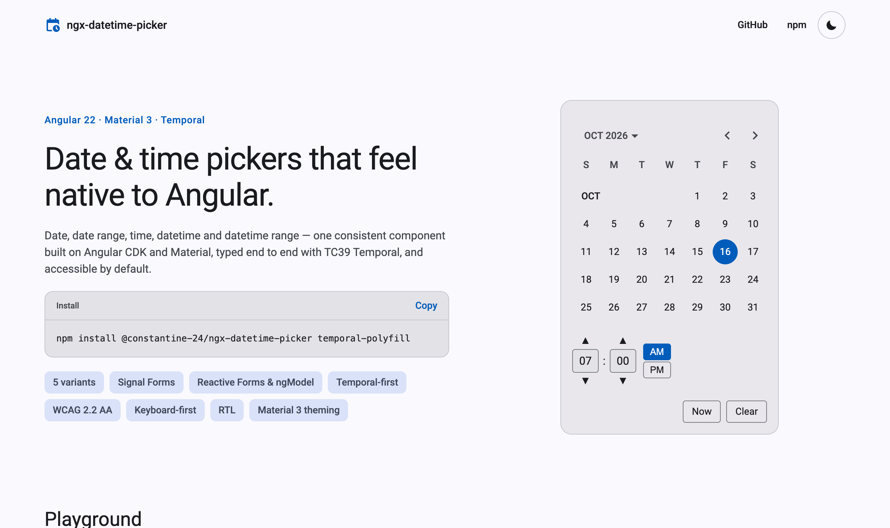

<div align="center">

# ngx-datetime-picker

**Date, time and range pickers for Angular — built on CDK & Material, powered by Temporal.**

[](https://www.npmjs.com/package/@constantine-24/ngx-datetime-picker)
[](https://github.com/Constantine-24/ngx-datetime-picker/actions/workflows/ci.yml)
[](https://angular.dev)
[](LICENSE)

[**Live demo & playground**](https://constantine-24.github.io/ngx-datetime-picker/) ·
[Documentation](projects/ngx-datetime-picker/README.md) ·
[Changelog](projects/ngx-datetime-picker/CHANGELOG.md)

<picture>
  <source media="(prefers-color-scheme: dark)" srcset="docs/images/demo-dark.png" />
  
</picture>

</div>

## Why ngx-datetime-picker?

- **Five variants, one component.** `date`, `date-range`, `time`, `datetime` and `datetime-range` share one API, popup or inline.
- **Temporal-first.** Values are `Temporal.PlainDate`, `PlainTime` and `PlainDateTime`, so there are no time-zone shifts and no off-by-one-day bugs from `Date`. The core is adapter-agnostic.
- **Every forms API.** One directive works with **Signal Forms**, Reactive Forms and `ngModel`, with built-in parse / min / max / filter / range-order validation.
- **Accessible by default.** WCAG 2.2 AA and axe-clean: a focus-trapped dialog, spinbutton time fields with full keyboard support, and screen-reader announcements.
- **Feels like Material 3.** Themed entirely by your `mat.theme()` tokens, so light and dark work out of the box. It also handles RTL and reduced motion.
- **The details forms need.** Min/max, date and time filters, 12/24-hour clocks, minute steps, seconds, side-by-side range calendars, and an Apply/Cancel draft mode.
- **Tree-shakeable.** The Temporal adapter lives in its own entry point.

## Installation

```bash
npm install @constantine-24/ngx-datetime-picker temporal-polyfill
```

| Peer dependency                     | Version                                 |
| ----------------------------------- | --------------------------------------- |
| `@angular/core`, `@angular/common`  | `^22.0.0`                               |
| `@angular/cdk`, `@angular/material` | `^22.0.0`                               |
| `temporal-polyfill`                 | `^0.3.0` (used by the Temporal adapter) |

Your app needs an Angular Material M3 theme (`ng add @angular/material` sets one up). The picker reads its colours, typography and shape from the `--mat-sys-*` tokens that `mat.theme()` emits.

## Quick start

**1. Provide an adapter.** `provideTemporalDateTimeAdapter()` covers every variant.

```ts
// app.config.ts
import { ApplicationConfig } from '@angular/core';
import { provideTemporalDateTimeAdapter } from '@constantine-24/ngx-datetime-picker/temporal';

export const appConfig: ApplicationConfig = {
  providers: [provideTemporalDateTimeAdapter()],
};
```

**2. Use a picker.** Here's a datetime field bound with Signal Forms:

```ts
import { Component, signal } from '@angular/core';
import { form, FormField } from '@angular/forms/signals';
import { MatFormFieldModule } from '@angular/material/form-field';
import { MatInputModule } from '@angular/material/input';
import { NgxDtDateTimeInput, NgxDtPicker, NgxDtToggle } from '@constantine-24/ngx-datetime-picker';
import { Temporal } from 'temporal-polyfill';

@Component({
  selector: 'app-meeting',
  imports: [
    FormField,
    MatFormFieldModule,
    MatInputModule,
    NgxDtPicker,
    NgxDtToggle,
    NgxDtDateTimeInput,
  ],
  template: `
    <mat-form-field>
      <mat-label>Meeting</mat-label>
      <input matInput [ngxDtDateTimeInput]="picker" [formField]="meeting.start" />
      <ngx-dt-toggle matSuffix [for]="picker" />
    </mat-form-field>
    <ngx-dt-picker #picker type="datetime" [minuteStep]="15" />
  `,
})
export class Meeting {
  protected readonly meeting = form(
    signal<{ start: Temporal.PlainDateTime | null }>({ start: null }),
  );
}
```

Want it always visible instead of in a popup? Use `<ngx-dt-picker type="datetime" [inline]="true" [(value)]="when" />`.

## Variants

| `type`           | Value                               | Bind it with                                                                     | Minimal provider                   |
| ---------------- | ----------------------------------- | -------------------------------------------------------------------------------- | ---------------------------------- |
| `date` (default) | `Temporal.PlainDate`                | `input[ngxDtInput]`                                                              | `provideTemporalDateAdapter()`     |
| `date-range`     | `DateRange<Temporal.PlainDate>`     | `<ngx-dt-date-range-input>` with `input[ngxDtStartDate]` / `input[ngxDtEndDate]` | `provideTemporalDateAdapter()`     |
| `time`           | `Temporal.PlainTime`                | `input[ngxDtTimeInput]`                                                          | `provideTemporalTimeAdapter()`     |
| `datetime`       | `Temporal.PlainDateTime`            | `input[ngxDtDateTimeInput]`                                                      | `provideTemporalDateTimeAdapter()` |
| `datetime-range` | `DateRange<Temporal.PlainDateTime>` | `<ngx-dt-datetime-range-input>` with `ngxDtStartDateTime` / `ngxDtEndDateTime`   | `provideTemporalDateTimeAdapter()` |

Every variant also works without an input: bind the picker's `[(value)]` or `[(range)]` model directly.

## Documentation

The full API reference is the [library README](projects/ngx-datetime-picker/README.md), which is also the npm page:

- [Entry points](projects/ngx-datetime-picker/README.md#entry-points) and [providers](projects/ngx-datetime-picker/README.md#providers)
- [Usage per variant](projects/ngx-datetime-picker/README.md#usage)
- [Picker inputs, models and outputs](projects/ngx-datetime-picker/README.md#picker-inputs)
- [Forms integration and validation error keys](projects/ngx-datetime-picker/README.md#forms-integration)
- [Theming](projects/ngx-datetime-picker/README.md#theming), [accessibility](projects/ngx-datetime-picker/README.md#accessibility) and [RTL](projects/ngx-datetime-picker/README.md#rtl)

Or try every option in the [**playground**](https://constantine-24.github.io/ngx-datetime-picker/). It generates the code for the configuration you pick.

## Compatibility

| ngx-datetime-picker | Angular / Material | Temporal                                                      |
| ------------------- | ------------------ | ------------------------------------------------------------- |
| 1.x                 | 22.x               | `temporal-polyfill` 0.3.x (imported by the `/temporal` entry) |

Supports evergreen browsers (Chrome, Edge, Firefox, Safari) and works with zoneless change detection and SSR.

## Contributing

Bug reports, ideas and pull requests are welcome. [CONTRIBUTING.md](CONTRIBUTING.md) explains the workspace, the development loop and the PR checklist.

```bash
npm ci
npm start            # demo + playground at http://localhost:4200
npm run test:ci      # unit tests (Vitest)
npm run build:lib    # build the package into dist/
```

## License

[MIT](LICENSE) © Konstantin Penzin
